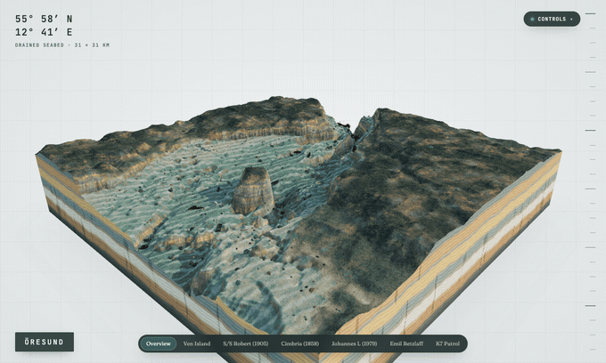

# Drained Seabed Explorer — Öresund, drained

An interactive 3D visualization of the Öresund strait with all its water removed.
Orbit between the Swedish and Danish coasts, past Helsingborg and Helsingør at the
narrows, over the tilted cliff-edged island of Ven, down the old shipping channel,
and among the real shipwrecks of the sound — stranded on a seabed of cracked mud,
salt flats and boulder shoals.



*Higher resolution: [media/demo.mp4](media/demo.mp4) · Static archival print: [media/preview.jpg](media/preview.jpg)*

## Run it

```sh
npm install && npm run dev
```

Then open the URL Vite prints (default: http://localhost:5173).

## Controls

- **Drag** — orbit the camera 360°
- **Space + drag** (or **right-drag**) — pan across the map
- **Scroll / pinch** — zoom in and out
- **Click any wreck, shoal, or place** — fly smoothly to the site and open its historical dossier card
- **Viewpoints bar** — quick-jump to Overview, Ven Island, S/S Robert (1905), Cimbria (1858), Johannes L (1979), Emil Retzlaff, and K7 Patrol
- **World Map** — zoom & pan anywhere on Earth over an interactive ocean-bathymetry atlas (with OpenSeaMap wreck/buoy overlays, place search, and famous wreck hotspots like Scapa Flow, Dover Strait, Normandy D-Day, Gibraltar, Geirangerfjord, and Truk Lagoon), choose a `15–100 km` capture window, and render a live 3D wreckmap from real EMODnet/GEBCO bathymetry + UKHO global shipwrecks (94,000+ wrecks worldwide)
- **Controls drawer** — toggle shipwrecks, boulder shoals, coastal places, site labels, Sentinel-2 satellite land overlay, bathymetric depth contours, lighting/atmosphere presets (*Archival*, *Golden Hour*, *Nordic Noon*, *Baltic Dusk*), 3D relief scale (starts at `0.50×`, range `0.25×–2.20×`), sun azimuth, and continuous sea-level refill/drain (`−52 m` ↔ `0 m`)

## What's in the scene

- **Archival 3D geological diorama**: A watertight bathymetric relief block set
  over a drafting-paper coordinate grid with live WGS84 telemetry, right-margin
  elevation ticks, stratified sienna/ochre/chalk cutaway walls, oxidized
  verdigris seabed valleys, weathered basalt-and-ochre cliffs, and ~720
  instanced seabed boulders. Switchable to *Golden Hour*, *Nordic Noon*, or
  *Baltic Dusk* physical-sky lighting presets, with toggleable `5 m / 15 m`
  bathymetric contours and adjustable 3D relief scale (`0.5×–2.2×`).
- **Real bathymetry**: EMODnet Bathymetry DTM 2024 (~115 m) merged with GEBCO
  2020 for land, covering lat 55.82–56.10 / lon 12.44–12.94 (≈31×31 km of the
  northern sound), enhanced with sculpted ridged crags, sedimentary ledges, and
  current-swept valley striations. Base vertical exaggeration: seabed ×2.15
  world-units/m, land ×1.25 with smooth tanh compression. Everything is authored
  in real WGS84 coordinates and projected via `geoToWorld`. Rebuild the grid
  with `node scripts/build-bathymetry.mjs`.
- **Depth-aware GPU water refill**: Toggle *Refill sound* or scrub *Sea level*
  continuously (`−52 m` ↔ `0 m`) to watch Beer-Lambert turquoise-to-navy water
  with animated shoreline foam flood the channels and surround Ven Island.
- **Optional satellite land overlay**: Sentinel-2 cloudless (EOX, 4096²) can be
  toggled over land areas while preserving the sculpted seabed and cliff faces.
  Refetch with `node scripts/build-satellite.mjs`.
- **Historically researched 3D wreck models**: Built with procedural riveted
  iron, weathered timber, and aged concrete PBR textures (albedo + bump + rust
  and verdigris patina), hollow hulls, recessed portholes/windows, masts with
  crosstrees and rigging, and seabed debris. Bespoke models reflect real Öresund
  dive-survey layouts:
  - **S/S Robert (1905)** — upright ~8° list, collapsed bridge, toppled funnel on
    deck, caved-in aft hold, fallen starboard aft mast, stern propeller & rudder.
  - **Cimbria (1858)** — fractured bow/stern sections, exposed spoked iron paddle
    wheels & drive shaft, boiler drum, and iron frames (*spantes*).
  - **Johannes L (1979)** — Sietas steel coaster resting ~76° on her port side
    with port-bow collision breach and open holds.
  - **S.S. Emil R. Retzlaff (1904)** — split into two angled hull halves exposing
    the triple-expansion engine and boiler.
  - **S/S Polaris (1924)** — tall stern/poop deck, flattened midship holds, and
    starboard collision breach.
  - **K7 Bevakningsfartyg** — exploded steel patrol vessel missing its bow
    section, with torn forward plates and stern gun ring.
  - **Ceylon af Bergkvara (1908)** & pre-1910 wooden barques/schooners — hollow
    ribbed oak hulls with blasted midship decks and spilled coal cargo.
  - **Cementbåten (1956)** & **Anemonvraket** — hollow multi-cell concrete
    caissons with internal cross-walls and protruding rusted rebar.
- **23 real wrecks** of the sound, cross-referenced from
  [oresundsdykning.se](https://www.oresundsdykning.se/vrak2/),
  [vragguiden.dk](https://www.vragguiden.dk/) (verified WGS84 positions), and
  [vrag.dk](https://www.vrag.dk/vrag-i-oeresund/) — 17 at charted coordinates, 2
  clamped to the map edge, 4 placed from historical location descriptions
  (marked approximate in `sites.js`). Click any wreck to fly in and open its
  historical dossier. Full harvested dataset: `docs/wrecks-oresundsdykning.json`.
- **Real shoals & labeled places**: Disken, Lappegrund, Grollegrund,
  Lundåkragrund; plus Helsingborg, Helsingør, Landskrona, Råå, Snekkersten,
  Borstahusen, Espergærde, Domsten, and Ven's villages Kyrkbacken and Sankt Ibb.

## Tech

- [Three.js](https://threejs.org/) — WebGL, physical `Sky` + PMREM IBL, 4K PCF
  soft shadow maps, custom GLSL terrain/cutaway/water shaders, ACES tone mapping
- [Vite](https://vite.dev/) — dev server and bundling
- Deterministic 512×512 bathymetry grid + procedural PBR wreck textures

## Project layout

```
drained-seabed-explorer/
├── index.html                     canvas + UI overlay root
├── package.json                   three + vite only
├── media/                         animated GIF, MP4, and archival print preview
└── src/
    ├── main.js                    integration glue, raycasting, telemetry
    ├── data/
    │   ├── geo.js                 WGS84 ↔ world projection
    │   ├── heightmap.js           real Öresund bathymetry + sculpted relief
    │   └── sites.js               REEFS (shoals), WRECKS (real), PLACES data
    ├── scene/
    │   ├── setup.js               renderer, sky/IBL, lighting presets, OrbitControls + Space-pan
    │   ├── terrain.js             3D cutaway relief block, cavity AO, instanced boulders
    │   ├── water.js               depth-aware GPU water & shoreline foam shader
    │   ├── wrecks.js              bespoke historically researched 3D wreck models + PBR patina
    │   └── markers.js             site anchors, smart distance-scaled labels, boulder shoals
    ├── materials/
    │   └── terrainMaterial.js     mineral diorama + stratified cutaway + contour shaders
    └── ui/
        ├── overlay.js             archival HUD, collapsible controls, viewpoints, site dossier card
        └── overlay.css            drafting-grid backdrop + responsive UI styles
```

Design doc: `docs/superpowers/specs/2026-07-11-drained-seabed-design.md`

## Recreate this for any region on Earth

This app was built by a team of AI sub-agents from a single `/goal` prompt in
[Claude Code](https://claude.com/claude-code). The full reusable prompt — with the
exact input data you need to provide (bounding box, places, wreck sources, depth
sanity checkpoints…) and the hard-won pitfalls to avoid — lives in
[`docs/GOAL-TEMPLATE.md`](docs/GOAL-TEMPLATE.md). Fill in the blanks for any
strait, bay or lake, paste it into `/goal`, and you get a drained replica of
your own waters.
